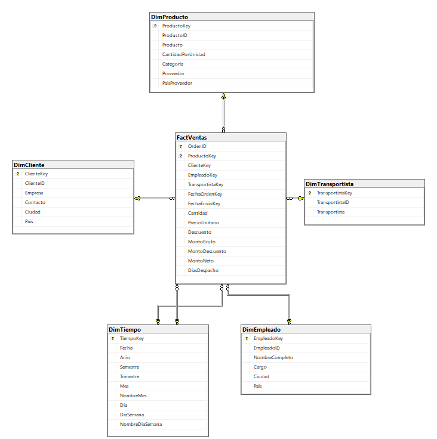

# Certamen 2 - Inteligencia de Negocios

## Caso seleccionado
**Caso 3 – Kent Foods.** Empresa que vende alimentos con envío a clientes en 21 países.

## Integrantes y sección
- Maximiliano Bono
- Cristian Salinas

**Sección:** 300

## Descripción del problema
Kent Foods creció rápido y su dueño toma decisiones sin una visión consolidada de las ventas. La base transaccional (`KentFoods`) registra órdenes, productos, clientes, empleados y transportistas, pero está pensada para operar, no para analizar. Se busca responder "¿Cuánto vendimos por categoría el último trimestre?" lo que exige unir 5–6 tablas y calcular montos que no están guardados.

## Objetivo del proyecto
Construir una solución de BI que permita al dueño seguir las ventas, los descuentos, el desempeño de los vendedores y el cumplimiento de los despachos.

---

## Análisis de la base transaccional (calidad y utilidad de los datos)

| Hallazgo | Dato | Consecuencia en el modelo |
|---|---|---|
| Período cubierto | Órdenes entre 04-07-2016 y 06-05-2018 (830 órdenes, 2.155 líneas de detalle) | `DimTiempo` se genera para 2016–2018. 2016 y 2018 son años incompletos: comparar períodos equivalentes. |
| Órdenes sin enviar | 21 órdenes (2,5 %) con `FechaEnvio` NULL | Se usa un miembro especial `-1 "Sin fecha"` en `DimTiempo`, y `DiasDespacho` queda en 0 (estas órdenes se excluyen al promediar). |
| Precio histórico | 658 líneas tienen un `PrecioUnitario` distinto al precio de lista actual de `Productos` | Las medidas se calculan con el precio de `DetalleOrden` (precio real cobrado), nunca con el de `Productos`. |
| Descuentos | Entre 0 % y 25 %; almacenados como `real` (ej. 0,05 se guarda como 0,0500000007) | Se convierte a `DECIMAL(4,2)` en el ETL. |
| País de envío | `PaisEnvio` coincide con el país del cliente en el 100 % de las órdenes; `CiudadEnvio` difiere solo en 13 órdenes de un cliente | No se crea una dimensión de destino: la geografía se analiza desde `DimCliente`. |
| Integridad | 0 líneas huérfanas, 0 órdenes sin detalle, 0 claves duplicadas, todos los productos con categoría y proveedor | Las FK del modelo se pueden cumplir sin filas "desconocido" en clientes, productos, etc. |
| Nulos en clientes | 1 cliente (HUNGO) sin código postal | No afecta: `CodigoPostal` no se incluye en la dimensión. |
| Clientes sin compras | 2 de 91 clientes | Se cargan igual en `DimCliente` (no aparecen en el hecho). |
| Territorios / Regiones | Relación muchos-a-muchos con empleados; la orden no registra territorio | Se excluyen (ver "Decisiones de diseño"). |
| Columnas sin uso analítico | `Imagen`, `Descripcion`, teléfonos, direcciones | Se excluyen. |

> No existe costo de los productos ni costo de flete en la base, por lo que **no es posible medir margen ni costo logístico**. Los KPI se limitan a lo que los datos permiten medir.

---

## KPI definidos

| # | KPI | Fórmula | Para qué decisión sirve | Valor actual (referencia) |
|---|---|---|---|---|
| 1 | **Ventas netas** y su crecimiento | `SUM(MontoNeto)`; crecimiento = (período actual − mismo período año anterior) / mismo período año anterior | Saber si el negocio crece y en qué categorías, productos o países | $1.265.792,53 total. Ene–abr 2018 vs ene–abr 2017: +120,7 % |
| 2 | **Ticket promedio por orden** | `SUM(MontoNeto) / COUNT(DISTINCT OrdenID)` | Evaluar si conviene impulsar compras más grandes por orden (combos, mínimos de compra) | $1.525,05 |
| 3 | **% de descuento otorgado** | `SUM(MontoDescuento) / SUM(MontoBruto)` | Controlar cuánto ingreso se pierde por descuentos y quién los otorga | 6,55 % |
| 4 | **Ventas por empleado** | `SUM(MontoNeto)` por `DimEmpleado` y participación sobre el total | Medir desempeño comercial y asignar metas o incentivos | — |
| 5 | **Tiempo promedio de despacho** | Promedio de `DiasDespacho` contando cada orden una vez (no cada línea) | Comparar transportistas y detectar demoras en la logística | 8,49 días por orden |
| 6 | **% de órdenes pendientes de envío** | órdenes con `FechaEnvioKey = -1` / total de órdenes | Detectar órdenes atrasadas que afectan la satisfacción del cliente | 2,53 % (21 órdenes) |

Los KPI 1–4 miden el **resultado comercial**; los KPI 5–6 miden la **operación de envío**, que es el núcleo del modelo de negocio de Kent Foods (vende "a través de envío").

---

## Modelo dimensional (4 pasos de Kimball)

### Paso 1 – Proceso de negocio
**Ventas**: La toma y despacho de órdenes de clientes. Es el proceso que genera ingresos y el único con hechos medibles en la base (Cantidades, precios, descuentos, fechas). Todos los KPI se calculan sobre él, por lo que basta **una sola tabla de hechos**.

### Paso 2 – Granularidad
**Una fila por cada producto vendido dentro de una orden** (= una fila de `DetalleOrden`).

Es el nivel más fino disponible. Se elige porque:
- Permite analizar por producto y categoría.
- Desde aquí se puede agregar a orden, cliente, mes, etc.
- Coincide 1 a 1 con la tabla origen, lo que simplifica el ETL y la validación.

### Paso 3 – Dimensiones

| Dimensión | Origen | Atributos | Responde a |
|---|---|---|---|
| `DimTiempo` | Generada por script | Fecha, Año, Semestre, Trimestre, Mes, NombreMes, Día, DíaSemana | ¿Cuándo? |
| `DimCliente` | `Clientes` | ClienteID, Empresa, Contacto, Ciudad, País | ¿A quién? ¿Dónde? |
| `DimProducto` | `Productos` + `Categorias` + `Proveedores` | Producto, CantidadPorUnidad, Categoría, Proveedor, PaísProveedor | ¿Qué? |
| `DimEmpleado` | `Empleados` | EmpleadoID, NombreCompleto, Cargo, Ciudad, País | ¿Quién vendió? |
| `DimTransportista` | `Transportistas` | TransportistaID, Transportista | ¿Quién despachó? |

`DimTiempo` cumple **dos roles** (role-playing dimension): fecha de la orden y fecha de envío.

`OrdenID` se guarda en el hecho como **dimensión degenerada**: no tiene atributos propios (todos ya están en otras dimensiones), pero se necesita para contar órdenes (`COUNT DISTINCT`) y calcular el ticket promedio.

### Paso 4 – Tabla de hechos y medidas
**`FactVentas`**

| Medida | Cálculo (en ETL) | Tipo |
|---|---|---|
| `Cantidad` | `DetalleOrden.Cantidad` | Aditiva |
| `PrecioUnitario` | `DetalleOrden.PrecioUnitario` | No aditiva (solo promediar) |
| `Descuento` | `DetalleOrden.Descuento` | No aditiva (porcentaje) |
| `MontoBruto` | `Cantidad × PrecioUnitario` | Aditiva |
| `MontoDescuento` | `MontoBruto × Descuento` | Aditiva |
| `MontoNeto` | `MontoBruto − MontoDescuento` | Aditiva |
| `DiasDespacho` | `DATEDIFF(DAY, FechaOrden, FechaEnvio)`; 0 si no se ha enviado | No aditiva (solo promediar) |

`DiasDespacho` se repite en todas las líneas de una orden: Un `AVG` directo sobre `FactVentas` pondera por líneas e incluye las 73 líneas no enviadas (con 0), y da 8,06 días; el KPI se calcula por orden y solo sobre órdenes enviadas (`FechaEnvioKey <> -1`): 8,49 días, lo que se resolverá en el cubo/Power BI promediando sobre órdenes distintas.

Los montos se **precalculan en el ETL** porque no existen en el origen y son la base de casi todos los KPI; así el cubo y Power BI solo suman.

### Tipo de esquema: estrella
Se eligió **estrella** y no copo de nieve porque:
- Las dimensiones son pequeñas (máx. 91 filas), por lo que repetir "Categoría" o "Proveedor" en cada producto no tiene costo relevante.
- Las consultas necesitan un solo JOIN por dimensión, son más simples y rápidas.
- Un copo de nieve (Como tener a `DimCategoria` y `DimProveedor` separados) agregaría tablas y ETL sin aportar análisis nuevo.

### Diagrama



Diagrama generado en SQL Server Management Studio (Database Diagrams de `KentFoodsDW`) a partir del modelo implementado.

---

## Implementación en SQL Server

Script: [`database/scripts/01_crear_modelo_dimensional.sql`](database/scripts/01_crear_modelo_dimensional.sql)

Qué hace cada bloque:

1. **Crea la base `KentFoodsDW`.** Si ya existe la elimina primero, para poder re-ejecutar el script desde cero. Se usa una base separada de `KentFoods` para no mezclar el mundo transaccional (OLTP) con el analítico (OLAP).
2. **Crea las 5 dimensiones.** Cada una tiene:
   - **Clave sustituta** (`...Key`, `INT IDENTITY`): Clave propia del DW, independiente del sistema origen. Protege al modelo si el origen cambia o reutiliza códigos, y permite JOIN rápidos por enteros (La clave del cliente en el origen es texto `NCHAR(5)`).
   - **Clave natural** (`ClienteID`, `ProductoID`, …): El ID original. El ETL la usa para buscar (Lookup) la clave sustituta al cargar el hecho.
   - Solo los atributos útiles para analizar; se descartaron direcciones, teléfonos, imágenes, etc.
   - Los cambios en las dimensiones se manejan como **Slowly Changing Dimension Tipo 1** (se sobrescribe), porque la base no guarda historial de cambios.
3. **`DimTiempo` usa clave inteligente `AAAAMMDD`** (ej. `20170315`) en vez de IDENTITY. Es legible y el ETL la obtiene directamente de la fecha (`CONVERT(INT, FORMAT(FechaOrden,'yyyyMMdd'))`) sin necesitar un Lookup.
4. **Crea `FactVentas`** con:
   - **PK compuesta `(OrdenID, ProductoKey)`**: representa exactamente el grano definido. Si el ETL intentara cargar una línea duplicada, SQL Server lo rechaza (control de calidad automático).
   - **7 claves foráneas** hacia las dimensiones (dos hacia `DimTiempo`). Garantizan que no se carguen hechos que apunten a dimensiones inexistentes.
   - Montos en `DECIMAL` (precisión exacta, sin errores de redondeo como `real`/`float`).
5. **Pobla `DimTiempo`** con un ciclo `WHILE` desde 01-01-2016 hasta 31-12-2018 (1.096 días) más la fila `-1 "Sin fecha"`. Nombres de mes y día en español con `CHOOSE`, independiente del idioma configurado en el servidor. Es la única dimensión que se carga en el script porque no viene del origen, mientras que el resto se carga con SSIS.

### Decisiones de diseño (¿Qué se dejó fuera y por qué?)
- **Territorios y Regiones:** Un empleado puede tener varios territorios y la orden no indica en cuál se vendió. Incluirlos requeriría una tabla puente y produciría doble conteo de ventas. La geografía ya se cubre con el país/ciudad del cliente y del empleado.
- **Dimensión de destino de envío:** Redundante, el país de envío siempre es el del cliente.
- **Tabla de hechos separada para envíos:** No es necesaria; las fechas de envío y los días de despacho caben en el mismo grano.

---

## Valores esperados para validar la carga (Fase 1 – ETL)

El script [`database/scripts/02_validacion_carga.sql`](database/scripts/02_validacion_carga.sql) compara automáticamente el origen con el DW (columna `Resultado` = OK). Valores de referencia:

| Validación | Valor esperado |
|---|---|
| Filas en `DimCliente` / `DimProducto` / `DimEmpleado` / `DimTransportista` | 91 / 77 / 9 / 3 |
| Filas en `DimTiempo` | 1.097 (1.096 días + fila -1) |
| Filas en `FactVentas` | 2.155 |
| Órdenes distintas (`COUNT(DISTINCT OrdenID)`) | 830 |
| Filas con `FechaEnvioKey = -1` | 73 líneas (de 21 órdenes) |
| `SUM(MontoBruto)` | 1.354.458,59 |
| `SUM(MontoNeto)` | 1.265.792,53 (el ETL trunca cada monto a 2 decimales) |
| Ventas netas por año | 2016: 208.083,93 · 2017: 617.084,91 · 2018: 440.623,69 |

---

## Proceso ETL - Fase 1
El proceso ETL se implementó en SQL Server Integration Services (SSIS) dentro de Visual Studio. El paquete `Main.dtsx` orquesta la extracción, transformación y carga desde la base transaccional `KentFoods` hacia el modelo dimensional `KentFoodsDW`.

**Flujo de Control (Control Flow):**
1. **`SQL_Delete_Tablas`**: Tarea SQL que limpia las tablas del DW en orden inverso de dependencia (usando `DELETE` para respetar las Foreign Keys).
2. **Carga de Dimensiones**: Cuatro tareas de flujo de datos (`DFT_Carga_Dim...`) que se ejecutan para cargar `DimCliente`, `DimTransportista`, `DimEmpleado` y `DimProducto`.
3. **`DFT_Carga_FACTVentas`**: Carga la tabla de hechos una vez que las dimensiones están pobladas.
4. **`SQL_Validacion_Carga`**: Tarea final que ejecuta el script de validación comparando el origen y el destino.

**Transformaciones clave en el Flujo de Datos (Data Flow):**
* **DimProducto**: Se utiliza un origen OLE DB con comando SQL para desnormalizar `Productos`, `Categorias` y `Proveedores` mediante `INNER JOIN`.
* **DimEmpleado**: Se usa un componente *Columna Derivada* (Derived Column) para concatenar `Nombre` y `Apellido` en `NombreCompleto`.
* **FactVentas**:
  * *Cálculos*: 3 componentes de *Columna Derivada* calculan `MontoBruto`, `MontoDescuento`, `MontoNeto` y `DiasDespacho` (manejando nulos en `FechaEnvio`).
  * *Lookups*: Seis componentes *Búsqueda* (Lookup) obtienen las claves sustitutas (`...Key`) de cada dimensión. Para las fechas, se genera una columna auxiliar en formato `AAAAMMDD` para coincidir con la clave inteligente de `DimTiempo`. Las órdenes sin envío se mapean a la clave `-1` ("Sin fecha").

**Validación:**
El paquete se valida ejecutando el script `02_validacion_carga.sql`. Se confirman 2.155 filas en `FactVentas`, 830 órdenes distintas y un monto neto total de $1.265.792,53.

## Tecnologías utilizadas
SQL Server, SQL Server Management Studio, Visual Studio (SSIS), GitHub.

## Estructura del repositorio
```
Inteligencia_de_Negocios_Grupo12/
|-- README.md
|-- .gitignore
|-- docs/
|   |-- modelo-dimensional/
|   |   `-- diagrama-estrella.png        Diagrama del modelo dimensional (SSMS)
|   |-- presentacion/                    
|   |   `-- Kent Foods – Fase 1.pptx     Presentación de la Fase 1
|   `-- informe/
|       `-- Informe_KentFoods_Fase1.docx      Informe de la Fase 1
|-- database/
|   |-- scripts/
|   |   |-- 01_crear_modelo_dimensional.sql   Crea KentFoodsDW y carga DimTiempo
|   |   `-- 02_validacion_carga.sql           Valida la carga después del ETL
|   `-- backup/
|       |-- KentFoods.bak                Base transaccional entregada (origen)
|       `-- KentFoodsDW                  Backup del DW con datos cargados
|-- etl/
|   `-- proyecto-ssis/
|       `-- KentFoods_ETL/
|           |-- KentFoods_ETL.sln        Solución de Visual Studio
|           `-- KentFoods_ETL/
|               |-- KentFoods_ETL.dtproj   Proyecto SSIS
|               |-- Main.dtsx              Paquete ETL
|               |-- KentFoods_ETL.database
|               `-- Project.params
|-- olap/
|   `-- proyecto-ssas/                   Fase 2
`-- powerbi/                             Fase 2 (dashboard.pbix)
```

## Instrucciones de ejecución/revisión
1. Restaurar `database/backup/KentFoods.bak` en SQL Server con el nombre **KentFoods**.
2. Ejecutar `database/scripts/01_crear_modelo_dimensional.sql` en SSMS. Crea la base **KentFoodsDW** con sus tablas, claves y relaciones, y carga `DimTiempo`.
3. Abrir `etl/proyecto-ssis/KentFoods_ETL/KentFoods_ETL.sln` en Visual Studio y ejecutar el paquete `Main.dtsx` (carga dimensiones, luego `FactVentas` y al final ejecuta la tarea `SQL_Validacion_Carga`).
4. Ejecutar `database/scripts/02_validacion_carga.sql` y verificar que todas las filas digan **OK**.
5. Alternativa para revisión rápida: restaurar `database/backup/KentFoodsDW`, que ya contiene los datos cargados.

## Avances por fase
| Fase | Estado |
|---|---|
| Fase 1 – Análisis de datos, KPI y 4 pasos de Kimball | Listo |
| Fase 1 – Modelo dimensional en SQL Server + diagrama | Listo |
| Fase 1 – Script de validación de la carga | Listo |
| Fase 1 – ETL en SSIS | Listo |
| Fase 1 – Backup de KentFoodsDW cargado | Listo |
| Fase 1 – Presentación | En progreso |
| Fase 2 – Cubo OLAP y Power BI | No iniciado |

## Distribución de responsabilidades y aportes

| Integrante | Responsabilidades | Entregables |
|---|---|---|
| Maximiliano Bono | Análisis de la base transaccional, definición de KPI, aplicación de los 4 pasos de Kimball, diseño e implementación del modelo dimensional, script de validación, informe (secciones de modelo dimensional) y presentación (sección de KPI y modelo) | `database/scripts/01_crear_modelo_dimensional.sql`, `database/scripts/02_validacion_carga.sql`, `docs/modelo-dimensional/`, estructura del repositorio y README |
| Cristian Salinas | Proceso ETL en SSIS (carga de dimensiones y de `FactVentas`), ejecución de la validación de la carga, generación del backup del DW, informe (sección ETL) y presentación (sección ETL y demostración) | `etl/proyecto-ssis/`, `database/backup/KentFoodsDW`, actualización del README con el ETL |